# Implementation Plan: Production Database Alignment & High-Throughput Optimization

> **Plan status: FINALIZED — implementation-ready target state**
>
> This document defines the approved production-alignment change set. It is not a
> statement that the repository already implements the target state. The current
> code still contains the legacy `in_status='S'` staging transition, Oracle BCD
> post-dispatch writebacks, per-request HTTP clients, and synthetic error strings;
> those are development-time implementation gaps to be removed by the work below.

**Target Workload**: 35,000 – 41,600 activations/day (09:00 AM – 09:00 PM)  
**Throughput Goal**: 7,500+ records/hour sustained  
**Scope**: Zero PostgreSQL DDL changes, verbatim Pyro error recording (no custom text), immediate stop on duplicate window (`415`/`5016`) and switch rejections (`5010`), eliminate `in_status` staging churn, remove post-recharge Oracle BCD writebacks, and implement bounded concurrency with persistent HTTP connection pooling.

---

## 1. Executive Summary & Production Discoveries

Through direct empirical analysis of the live Oracle database (`CAF_ADMIN.BCD` and `FRC_REQUEST_DATA`) across >700,000 records, the following core operational realities have been established:

1. **Volume Profile**: Real weekday arrival is **35,000 to 41,600 activations/day**, with midday peak rates exceeding **2,100 activations/hour** (~62 activations/min).
2. **`CAF_ADMIN.BCD` is Strictly an Ingestion Queue**:
   * It is updated **only once** by the populator: `FRC_FLOW_STATUS = 'RQ'`, `FRC_REQID = <id>`, and `REMARKS = 'N101: request inserted'`.
   * **It is NEVER updated after recharge.** Over 2.23 million records stay in `RQ` with `N101` permanently. Statuses `P` (Paid) and `W` (Waiting) have **0 records all-time**.
3. **Zero PostgreSQL Schema Changes (0 DDL)**:
   * We do **NOT** add `frcstatus`. The existing PostgreSQL table (`public.frc_pyro_request_data`) already contains all necessary columns:
     * `push_flag`: `'N'` (New), `'P'` (In-flight), `'Y'` (Success), `'E'` (Retry), `'F'` (Failed)
     * `pyro_status`: `'N'` (New), `'REG'` (Registered), `'SUC'` (Success), `'FAL'` (Failed)
     * `final_status`: `'SUCCESS'`, `'FAILED'`
     * `pyro_final_statuscode`: Stores the exact numeric Pyro status code (`2000`, `415`, `5016`, `5010`, `405`, `5006`, `5011`)
     * `last_error_msg`: **The exact, verbatim error message received from Pyro** (`response.get("message")`)
     * `msg_afterreq`: Full raw Pyro JSON response
4. **Duplicate Window (`415` / `5016`) & Switch FRC Check (`5010`) = Immediate Terminal Stop**:
   * **Synchronous (`415` / `5016`)**: When Pyro detects duplicate request within 10–15 min window, we **must NOT retry**. Retrying risks double-debiting dealer balance.
   * **Asynchronous (`5010`)**: When the IN switch rejects with `"Recharge failed. Only First Recharge (FRC) accounts or plans are allowed"` (already FRC done), the status poller and callback **must stop polling immediately**.
   * Both are marked: `push_flag = 'F'`, `pyro_status = 'FAL'`, `final_status = 'FAILED'`, `pyro_final_statuscode = status_code`, and `last_error_msg = response.get("message")`.
5. **`last_error_msg`, `remarks`, and `push_remarks` are Clean**:
   * **`last_error_msg`**: Strictly contains what Pyro returns (`response.get("message")`). No hardcoded or synthetic strings.
   * **`push_remarks`**: Starts as `NULL` on insert (no arbitrary legacy strings). Retains internal pipeline stage tracking (`'Claimed for Pyro dispatch'`, `'Submitted to Pyro'`, `'Recharge successful'`).
   * **`remarks`**: Left as `NULL` (no external switch data).
6. **`IN_STATUS = 'C'` was Static**: The legacy system never had an `'S'` (staged) status. Records were inserted directly as `'C'` (Confirmed) and stayed `'C'` permanently.
7. **No Async Callbacks in Practice**: Pyro relies on the **Status Poller** in production (`REPLYMSG` is 100% NULL in legacy). Webhook callback handling is retained for dual-channel support.

---

## 2. Architecture: Streamlined Pipeline

```mermaid
flowchart TD
    subgraph Populator["1. Population (Every 5 min)"]
        A1["Read CAF_ADMIN.BCD\nACTIVATION_STATUS='C'\nFRC_FLOW_STATUS='NP'"] --> A2["Match Postgres KYC\n(cos_bcd / cos_bcd_dkyc)"]
        A2 --> A3["Insert Postgres frc_pyro_request_data\nin_status = 'C' (Directly Ready!)\npush_flag = 'N', pyro_status = 'N'\npush_remarks = NULL"]
        A3 --> A4["Update Oracle CAF_ADMIN.BCD (ONCE ONLY)\nFRC_FLOW_STATUS = 'RQ'\nFRC_REQID = reqid\nREMARKS = 'N101: request inserted'"]
    end

    subgraph Recharge["2. Recharge Dispatch (Every 2 min, Concurrency=4)"]
        B1["Claim Rows via FOR UPDATE SKIP LOCKED\npush_flag = 'P', push_remarks = 'Claimed for Pyro dispatch'"] --> B2["Persistent httpx Client + Smart Token Cache"]
        B2 --> B3["Call Pyro /epin-vendor-api/recharge"]
        B3 --> B4{"Pyro Initial Response"}
        B4 -->|"2002 (Registered)"| B5["push_flag = 'P'\npyro_status = 'REG'\npyro_trans_id = txn_id\nSchedule Status Check"]
        B4 -->|"415 / 5016 (Duplicate Window)"| B6["STOP IMMEDIATELY (No Retry!)\npush_flag = 'F'\npyro_status = 'FAL'\nfinal_status = 'FAILED'\npyro_final_statuscode = status_code\nlast_error_msg = response.get('message')"]
        B4 -->|"405 (Dealer Low Balance)"| B7{"attempt < max_retries?"}
        B7 -->|"Yes (Retryable)"| B8["push_flag = 'E'\npyro_status = 'FAL'\nlast_error_msg = response.get('message')\nSkip dealer for rest of batch"]
        B7 -->|"No (Exhausted)"| B9["push_flag = 'F'\npyro_status = 'FAL'\nfinal_status = 'FAILED'\nlast_error_msg = response.get('message')"]
        B4 -->|"5006 / 5011 (Wrong MPIN / Barred)"| B10["push_flag = 'F'\npyro_status = 'FAL'\nfinal_status = 'FAILED'\nlast_error_msg = response.get('message')"]
    end

    subgraph StatusCheck["3. Status Poller (Every 5 min)"]
        C1["Poll Pyro /epin-vendor-api/transaction-status"] --> C2{"Poller Outcome"}
        C2 -->|"2000 SUCCESS"| C3["push_flag = 'Y'\npyro_status = 'SUC'\nfinal_status = 'SUCCESS'\nCapture dealer_bal_before/after"]
        C2 -->|"5010 (Already FRC Done) / 5005 / 5030 / 902"| C4["STOP POLLING IMMEDIATELY\npush_flag = 'F'\npyro_status = 'FAL'\nfinal_status = 'FAILED'\nlast_error_msg = response.get('message')"]
        C2 -->|"2002 / 901 (In Process)"| C5{"poll_attempt < max?"}
        C5 -->|"Yes"| C6["Keep push_flag = 'P'\nAwait next poller cycle"]
        C5 -->|"No (Timed out)"| C7["push_flag = 'F'\nfinal_status = 'FAILED'"]
    end
```



---

## 3. Core Decisions Summary

> [!IMPORTANT]
> **1. Zero Database Changes (0 DDL)**:
> No schema migrations or table alters. Status tracking uses existing columns: `push_flag`, `pyro_status`, `final_status`, `pyro_final_statuscode`, `last_error_msg`, `msg_afterreq`.

> [!IMPORTANT]
> **2. `last_error_msg` is Strictly Verbatim from Pyro**:
> `last_error_msg` stores `response.get("message")` directly from Pyro Gateway. No custom or synthetic text is injected.

> [!IMPORTANT]
> **3. Stop Immediate on Duplicate Window (`415` / `5016`) & Switch Code `5010`**:
> - Never retry `415` or `5016` (prevents double-debiting dealer balance).
> - Never continue polling on `5010` ("Only First Recharge accounts allowed" = Already FRC done).
> - Set `push_flag = 'F'`, `pyro_status = 'FAL'`, `final_status = 'FAILED'`.

> [!IMPORTANT]
> **4. Remarks Cleanliness**:
> - `push_remarks`: Starts `NULL` on insert; continues internal tracking (`Claimed`, `Submitted`, `Recharge successful`).
> - `remarks`: Kept `NULL`.

> [!IMPORTANT]
> **5. Eliminate `in_status` Staging Churn**:
> Rows are inserted directly with `in_status = 'C'`. Remove
> `mark_requests_dispatchable()` and the associated staging update, eliminating a
> full-table batch update per cycle.

> [!IMPORTANT]
> **6. Zero Secondary Oracle BCD Writebacks**:
> Deletes all `update_bcd_status` calls from processor, callback, and status checker. Zero Oracle connections or row locks during recharge execution.

---

## 4. Status Column Mapping Matrix

| Scenario | `push_flag` | `pyro_status` | `final_status` | `pyro_final_statuscode` | `last_error_msg` (Verbatim from Pyro) |
| :--- | :---: | :---: | :---: | :---: | :--- |
| **Auto-FRC Success** | **`'Y'`** | **`'SUC'`** | `'SUCCESS'` | `2000` | `NULL` |
| **Duplicate Window (`415`, `5016`)** | **`'F'`** | **`'FAL'`** | `'FAILED'` | **`415` / `5016`** | Pyro message (e.g. `"Duplicate subscriber window..."`) |
| **Already FRC Done on Switch (`5010`)** | **`'F'`** | **`'FAL'`** | `'FAILED'` | **`5010`** | Pyro message (`"Recharge failed. Only First Recharge (FRC) accounts..."`) |
| **Dealer Low Balance (`405`) — Retrying** | **`'E'`** | **`'FAL'`** | `NULL` | **`405`** | Pyro message (`"Sorry, You have insufficient stock..."`) |
| **Dealer Low Balance (`405`) — Max Retries Reached** | **`'F'`** | **`'FAL'`** | `'FAILED'` | **`405`** | Pyro message (`"Sorry, You have insufficient stock..."`) |
| **Wrong MPIN / Barred (`5006`, `5011`)** | **`'F'`** | **`'FAL'`** | `'FAILED'` | **`5006` / `5011`** | Pyro message (`"WRONG MPIN..."` / `"Sorry, Your account is suspended..."`) |
| **In-Flight (Awaiting Poller)** | **`'P'`** | **`'REG'`** | `NULL` | `2002` | `NULL` |

---

## 5. File-by-File Implementation Details

### Component 1: Ingestion (Directly Dispatchable)

#### [MODIFY] [`app/db/postgres.py`](file:///D:/pyro/pyro_auto_frc/app/db/postgres.py)
* In `bulk_insert_frc_requests()`:
  - Insert directly with `in_status = 'C'`.
  - Leave `push_remarks = NULL` and `remarks = NULL`.
* Remove `mark_requests_dispatchable()` and its async wrapper.
* Remove staged-row recovery queries and reconciler branches that exist only for
  the `S -> C` transition. No data migration is needed for this clean-slate
  development rollout.

#### [MODIFY] [`app/batch/populator.py`](file:///D:/pyro/pyro_auto_frc/app/batch/populator.py)
* Remove the `mark_requests_dispatchable()` call from the populator.

---

### Component 2: Oracle BCD Staging Remark Alignment & Writeback Removal

#### [MODIFY] [`app/db/oracle.py`](file:///D:/pyro/pyro_auto_frc/app/db/oracle.py)
* In `batch_writeback_bcd_rq()` (Line 183):
  Set `FRC_FLOW_REMARKS = 'N101: request inserted'`.
* In `update_bcd_status()`:
  Remove the function and its imports once all active callers are removed.

#### [MODIFY] [`app/processor.py`](file:///D:/pyro/pyro_auto_frc/app/processor.py)
* Remove all calls to `update_bcd_status` (lines 38–41, 160–163, 206–208).

#### [MODIFY] [`app/callback.py`](file:///D:/pyro/pyro_auto_frc/app/callback.py)
* Remove all calls to `update_bcd_status` (lines 137, 151).

#### [MODIFY] [`app/status_checker.py`](file:///D:/pyro/pyro_auto_frc/app/status_checker.py)
* Remove all calls to `update_bcd_status` (lines 47, 69, 80, 95, 116).

---

### Component 3: Recharge Processor (Duplicate Stop & Verbatim Pyro Errors)

#### [MODIFY] [`app/processor.py`](file:///D:/pyro/pyro_auto_frc/app/processor.py)
1. **Handle duplicate window as terminal stop (`415`, `5016`)**:
   ```python
   elif status_code in (415, 5016):
       pyro_msg = response.get("message")
       await async_mark_as_failed(
           reqid, FLAG_FAILED, pyro_msg, response_text, status_code
       )
       logger.info("reqid=%s Duplicate window stopped: %s", reqid, pyro_msg)
   ```

2. **Handle dealer low balance (`405`) with retry limit**:
   ```python
   elif status_code == 405:
       exhausted_dealers.add(dealer_msisdn)
       pyro_msg = response.get("message")
       await _handle_transient(
           row, reqid, caf, pyro_msg, response_text, status_code
       )
   ```

3. **In `_handle_transient()`**:
   Pass verbatim Pyro message and transition to `FLAG_FAILED` when max retries reached:
   ```python
   async def _handle_transient(row, reqid, caf, pyro_msg, response_text, status_code):
       attempt = int(row["retry_count"]) + 1
       flag = FLAG_FAILED if attempt >= int(row["max_retries"]) else FLAG_RETRY
       await async_mark_as_failed(reqid, flag, pyro_msg, response_text, status_code)
   ```

---

### Component 4: Status Checker & Callback (`5010` Already FRC Done)

#### [MODIFY] [`app/status_checker.py`](file:///D:/pyro/pyro_auto_frc/app/status_checker.py)
* Add explicit check for IN Switch failure codes:
  ```python
  if status_code == 2000:
      balance_before = inner.get("dealerBalanceBefore", 0.0)
      balance_after = inner.get("dealerBalanceAfter", 0.0)
      await async_mark_as_success(reqid, response_text, balance_before, balance_after, status_code)
      success += 1

  elif status_code in (5010, 5030, 5005, 5011, 5012, 902):
      # Terminal IN switch failure (5010 = Already FRC done!) -> Stop polling immediately
      pyro_msg = response.get("message")
      await async_mark_as_failed(reqid, FLAG_FAILED, pyro_msg, response_text, status_code)
      failed += 1

  elif status_code in (2002, 901):
      # In process -> continue polling up to max attempts
      if attempt_no >= settings.status_check_max_attempts:
          await async_mark_as_failed(reqid, FLAG_FAILED, response.get("message"), response_text, status_code)
          failed += 1
      else:
          retry += 1
  ```

#### [MODIFY] [`app/callback.py`](file:///D:/pyro/pyro_auto_frc/app/callback.py)
* Handle `5010`, `5030`, `5005`, etc., as terminal `FLAG_FAILED` with verbatim Pyro error message.

---

### Component 5: High-Throughput Optimization (Concurrency, Pooling, Token Cache)

#### [MODIFY] [`app/config.py`](file:///D:/pyro/pyro_auto_frc/app/config.py)
```python
recharge_batch_size: int = 500
recharge_concurrency: int = 4            # Ramp: 4 conservative, 8 target
status_check_batch_size: int = 100
```

#### [MODIFY] [`app/processor.py`](file:///D:/pyro/pyro_auto_frc/app/processor.py)
* Wrap dispatch calls in `asyncio.Semaphore(settings.recharge_concurrency)` + `asyncio.gather()`.
* Early abort on auth token failure with `async_release_unprocessed_claims()`.

#### [MODIFY] [`app/pyro_client.py`](file:///D:/pyro/pyro_auto_frc/app/pyro_client.py)
* Shared persistent `httpx.AsyncClient` with connection pooling (`Limits(max_keepalive_connections=20, max_connections=50)`).

#### [MODIFY] [`app/auth/token_manager.py`](file:///D:/pyro/pyro_auto_frc/app/auth/token_manager.py)
* Skip `refresh_access_token()` if token is still valid (`_is_access_token_valid()`).

#### [MODIFY] [`app/db/postgres.py`](file:///D:/pyro/pyro_auto_frc/app/db/postgres.py)
* Add `LIMIT %s` to `fetch_pushed_rows_for_status_check()`.

---

### Component 6: Sizing & Scheduling Configuration (`.env`)

```ini
# ── Batch Population (Every 5 min) ───────────────────────────
ORACLE_BATCH_FETCH_SIZE=350
SCHEDULER_BATCH_POPULATION_INTERVAL_MINUTES=5
SCHEDULER_BATCH_POPULATION_GRACE_SECONDS=180

# ── Recharge Processing (Every 2 min) ─────────────────────────
RECHARGE_BATCH_SIZE=250
RECHARGE_CONCURRENCY=4
SCHEDULER_RECHARGE_INTERVAL_MINUTES=2
SCHEDULER_RECHARGE_GRACE_SECONDS=90

# ── Status Check (Every 5 min) ────────────────────────────────
STATUS_CHECK_BATCH_SIZE=100
STATUS_CHECK_MAX_ATTEMPTS=5
SCHEDULER_STATUS_CHECK_INTERVAL_MINUTES=5
SCHEDULER_STATUS_CHECK_GRACE_SECONDS=60

# ── Startup Flags ─────────────────────────────────────────────
RUN_CLEANUP_ON_STARTUP=true
RUN_BATCH_ON_STARTUP=false
RUN_RECHARGE_ON_STARTUP=false
RUN_DEBIT_ON_STARTUP=false
```

---

## 6. Verification Plan

## 7. Finalized Delivery Sequence and Safety Gates

The work must be delivered in the following order. A later phase must not be
enabled in production until the preceding gate passes.

### Phase 0 — Baseline and clean-slate inventory

1. Record the current application version, configuration, pending-row counts,
   and Oracle/PostgreSQL reconciliation counts. Confirm that no development
   database contains rows requiring `S -> C` recovery.
2. Run the existing unit, concurrency, database, and integration suites before
   changing behavior. The current tests encode the old `S -> C` and Oracle
   writeback contract, so they must be updated together with the implementation;
   they are not evidence that the finalized behavior is already present.
3. Confirm that the deployment has no second worker process or overlapping
   scheduler instance that could bypass the claim lock.

**Gate:** baseline results and the rollback target are captured.

### Phase 1 — State and error-contract changes

1. Change new PostgreSQL rows to `in_status='C'`, `push_flag='N'`,
   `pyro_status='N'`, with both `push_remarks` and `remarks` null.
2. Remove `mark_requests_dispatchable()`, its async wrapper, the `S` recovery
   queries, and reconciler branches that only support staged rows.
3. Keep the Oracle BCD claim as the single ingestion writeback. Set the remark
   to exactly `N101: request inserted`.
4. Remove all recharge, callback, and status-check calls to `update_bcd_status`.
   Remove the function and imports after all callers are migrated.
5. For every Pyro response, pass `response.get("message")` unchanged to
   `last_error_msg`. Do not use fallback text, status-code prefixes, retry
   explanations, dealer identifiers, or max-attempt text as the stored error.
   Operational context belongs in logs and `push_remarks` only.

**Gate:** unit tests prove exact message preservation, terminal-field mappings,
and zero post-recharge Oracle calls.

### Phase 2 — Terminal and retry state machine

1. `415` and `5016` are terminal failures: no retry, no delayed retry, and no
   dealer-balance skip behavior. Mark `F/FAL/FAILED` with the exact code and
   Pyro message.
2. `5010` (and the approved terminal switch-failure set) is terminal in both
   the status poller and callback. Stop polling immediately and mark
   `F/FAL/FAILED` with the exact Pyro message.
3. `405` remains retryable until `max_retries`; while processing a batch, stop
   submitting additional rows for the same dealer after the first `405`.
   Rows skipped for that reason must be released without inventing a Pyro
   error message.
4. `2002` is registered/in-flight; `2000` is success. `901` and the approved
   in-process codes continue polling only while the attempt limit permits.
5. Make terminal updates idempotent so a late callback cannot overwrite a
   terminal poller result.

**Gate:** focused tests cover `415`, `5016`, `5010`, `405` retry exhaustion,
late callbacks, and exact terminal field values.

### Phase 3 — Throughput changes

1. Add bounded dispatch concurrency with a semaphore. Start at concurrency 4;
   raise to 8 only after soak evidence supports it.
2. Use one shared lifecycle-managed `httpx.AsyncClient` for Pyro calls, with
   explicit startup/shutdown and configured limits/timeouts. Do not create an
   `AsyncClient` inside each request.
3. Avoid unnecessary token refreshes by honoring the JWT expiry safety window;
   serialize refreshes through the existing auth lock.
4. Add the configured `LIMIT` to status-check selection and retain atomic
   PostgreSQL claiming with `FOR UPDATE SKIP LOCKED`.
5. Keep scheduler `max_instances=1`, coalescing, and advisory/claim locking;
   measure job duration so the two-minute recharge interval is not silently
   overrun.

**Gate:** a production-like soak demonstrates at least 7,500 records/hour,
zero duplicate claims, bounded database connections, and no unreleased claims.

### Phase 4 — Canary, ramp, and rollback

1. Canary one zone or a controlled slice with startup execution disabled.
2. Ramp dispatch concurrency 4 -> 6 -> 8 only when error rate, latency,
   token failures, database pool utilization, and claim-release metrics remain
   within agreed limits for a complete peak window.
3. Roll back by disabling the new scheduler jobs, restoring the previous
   application image/configuration, and leaving already-terminal PostgreSQL
   rows untouched. Do not replay `415`, `5016`, or `5010` rows.
4. Reconcile Oracle `RQ` claims against PostgreSQL request IDs before resuming
   any retry traffic. Any mismatch is a release blocker.

## 8. Final Acceptance Checklist

- [ ] No DDL, migration, or new PostgreSQL column is required.
- [ ] New rows are dispatchable immediately; no `S` staging state or recovery
      path remains in the clean-slate development deployment.
- [ ] Oracle BCD is written only by ingestion claim, with exact `N101` remark.
- [ ] No recharge, callback, or status-check path calls `update_bcd_status`.
- [ ] `last_error_msg` is exactly the Pyro `message` value, including null when
      Pyro omits it; synthetic text is never persisted there.
- [ ] `415`/`5016` never retry; `5010` never polls again.
- [ ] Callback and poller terminal updates are idempotent.
- [ ] Auth failure releases all unsubmitted claims.
- [ ] Shared HTTP pooling and bounded concurrency are observable and bounded.
- [ ] Scheduler overlap, database pool saturation, API latency, terminal-code
      counts, retry counts, and unreleased claims have alerts or dashboards.
- [ ] Canary and peak-window evidence is attached to the release record.

## 9. Verification Commands and Evidence

### Automated Tests
```bash
cd D:/pyro/pyro_auto_frc
python -m pytest tests/unit/ -v
python -m pytest tests/concurrency/test_dispatch_concurrency.py -v
python -m pytest tests/integration/test_all_regression.py -v
```

### Key Verification Criteria
1. **Zero Database Migrations**: Verify no table alters or new columns are required.
2. **Pure Verbatim Messages**: Verify `last_error_msg` contains strictly the message returned by Pyro (`response.get('message')`).
3. **Zero Duplicate Retries**: Verify `415` and `5016` are marked `push_flag = 'F'` and never retried.
4. **Immediate Stop on Code `5010`**: Verify `status_checker.py` and `callback.py` terminate polling immediately when `5010` arrives.
5. **Zero `in_status` Churn**: Verify rows are inserted directly with `in_status = 'C'`.
6. **Zero Post-Recharge Oracle Calls**: Verify `update_bcd_status` is never called during recharge dispatch or callbacks.
7. **N101 Remark**: Verify Oracle BCD staging update sets `REMARKS = 'N101: request inserted'`.
8. **Throughput**: Verify the production-like batch target and at least 7,500
   records/hour sustained at concurrency 4; do not treat a fixed 250-row
   timing as the sole acceptance criterion.
